<div align="center">

# 🧠 Machine Learning Coursework (ML-CW)

**Two complete, end-to-end machine learning projects — a tabular income classifier and a deep-learning-powered plant disease classifier.**

[](https://python.org)
[](https://scikit-learn.org)
[](https://pytorch.org)
[](https://streamlit.io)
[](#-license)

</div>

---

## 📖 Overview

This repository contains **two machine learning projects** developed for a university Machine Learning module. Each project follows a full, reproducible ML workflow: problem framing → data understanding → preprocessing → feature engineering → model training → evaluation → comparison → simple deployment.

| # | Project | Domain | Task | Core approach | Headline result |
|---|---------|--------|------|---------------|-----------------|
| 1 | [🌿 Cassava Leaf Disease Classification](#-project-1--cassava-leaf-disease-classification) | Computer vision (agriculture) | 5-class image classification | VGG16 transfer-learning features + PCA + classical ML | **SVM (RBF): 70.2% acc, 0.885 macro AUC** |
| 2 | [💼 Adult Income Predictor Pro](#-project-2--adult-income-predictor-pro) | Tabular (socio-economic) | Binary classification | Feature engineering + linear / distance / ensemble models | **Logistic Regression: 86.0% acc, 0.912 ROC-AUC** |

Both projects include trained artifacts, generated JSON/CSV metrics, publication-quality plots (included below), and a lightweight deployment surface (a Python prediction package and a Streamlit app).

---

## 🗂 Repository Structure

```text
ML-CW/
│
├── adult_income_pro_app/              # 💼 Project 2 — Tabular income classification
│   ├── app.py                         #    Streamlit application (Dashboard/Explorer/Model Lab/Predict)
│   ├── train_model.py                 #    Training + evaluation + artifact export
│   ├── requirements.txt
│   ├── README.md
│   ├── assets/                        #    model_results.json + saved notebook plots
│   ├── data/                          #    UCI Adult dataset (adult.data / adult.test / adult.names)
│   ├── notebooks/                     #    adult_income_coursework.ipynb
│   └── src/                           #    config.py · data_utils.py · features.py
│
├── cassava-disease_MLCW/             # 🌿 Project 1 — Image-based disease classification
│   ├── 01_data_exploration.ipynb      #    EDA & visualization
│   ├── 02_data_preprocessing.ipynb    #    Resizing, normalization, augmentation, class weights
│   ├── 03_feature_engineering.ipynb   #    VGG16 feature extraction + StandardScaler + PCA
│   ├── 04_model_training.ipynb        #    LR · SVM · Random Forest · neural head
│   ├── 05_hyperparameter_tuning.ipynb #    GridSearchCV / RandomizedSearchCV
│   ├── 06_model_evaluation.ipynb      #    Metrics, ROC, confusion, model selection
│   ├── 07_deployment.ipynb            #    CassavaClassifier prediction interface
│   ├── predict.py                     #    Standalone CLI predictor
│   ├── outputs/                       #    All generated plots, metrics and configs
│   ├── ML_Coursework_Report.md        #    Full written report
│   ├── USAGE.md · requirements.txt · README.md
│
└── .gitignore · .vscode/ · .idea/
```

---

# 🌿 Project 1 — Cassava Leaf Disease Classification

> **Task:** Multi-class image classification of cassava leaf conditions from photographs.
> **Approach:** Hybrid pipeline — a pre-trained **VGG16** CNN extracts deep visual features, which are standardised and compressed with **PCA**, then classified by traditional ML models (**Logistic Regression, SVM, Random Forest**) plus an optional neural head.
> **Best model:** **SVM (RBF)** — best macro F1 and macro AUC.

### 🎯 The five classes

| Class | Disease name | Meaning | Train images |
|-------|--------------|---------|-------------:|
| `cbb` | Cassava Bacterial Blight | Bacterial infection causing leaf spots | 466 |
| `cbsd` | Cassava Brown Streak Disease | Viral disease affecting leaves and roots | 1,443 |
| `cgm` | Cassava Green Mite | Pest damage from green mites | 773 |
| `cmd` | Cassava Mosaic Disease | Most common viral disease | 2,658 |
| `healthy` | Healthy | No disease present | 316 |
| | | **Total** | **5,656** |

### 🔄 Pipeline

```text
  Input image
      │  resize 224×224, ImageNet mean/std normalisation
      ▼
  VGG16 (ImageNet weights, frozen)  ──►  deep feature vector
      │
      ▼
  StandardScaler (fit on train only)
      │
      ▼
  PCA  ──►  3,201 components · 94.83% explained variance
      │
      ▼
  Classifier (Logistic Regression / SVM-RBF / Random Forest / neural head)
      │
      ▼
  Predicted class + confidence
```

---

## 1️⃣ Data Exploration (Notebook 01)

The dataset is strongly **imbalanced** (max/min ratio **8.41**): CMD accounts for almost half of all images while *healthy* has only 316. Image dimensions also vary widely (mean **614 × 568 px**), which justifies uniform resizing.

| Class distribution | Sample images per class |
|:---:|:---:|
| 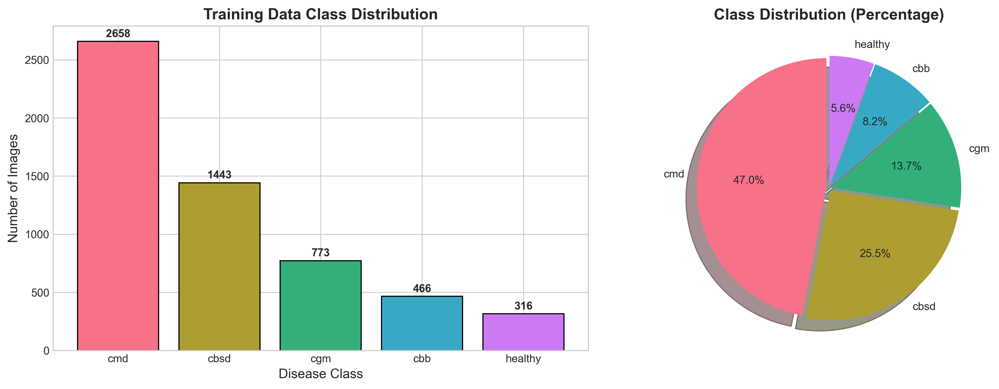 | 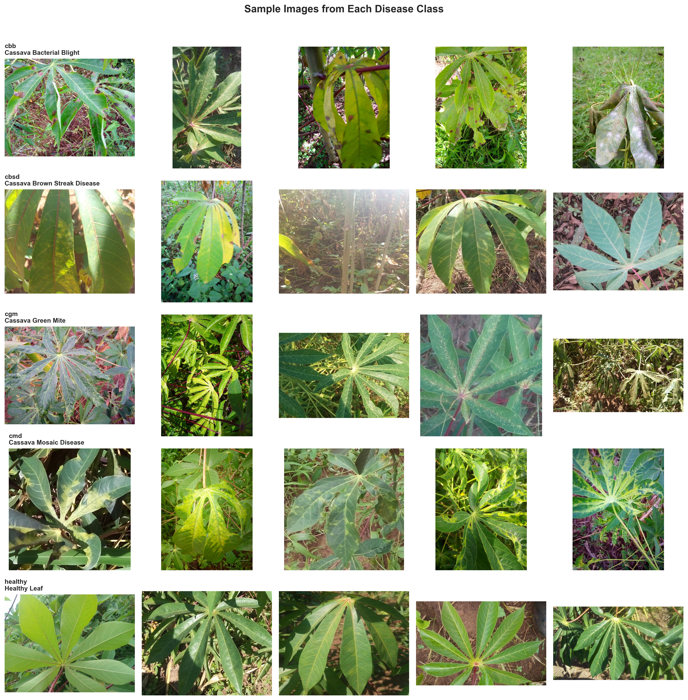 |

| Image dimension analysis | Colour histogram analysis |
|:---:|:---:|
| 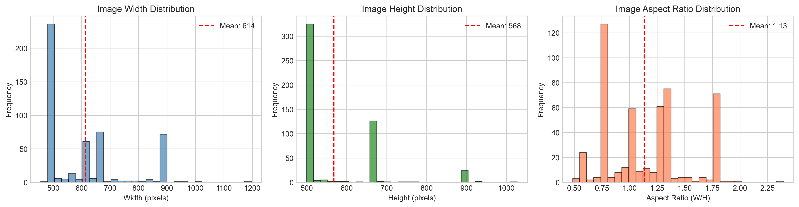 | 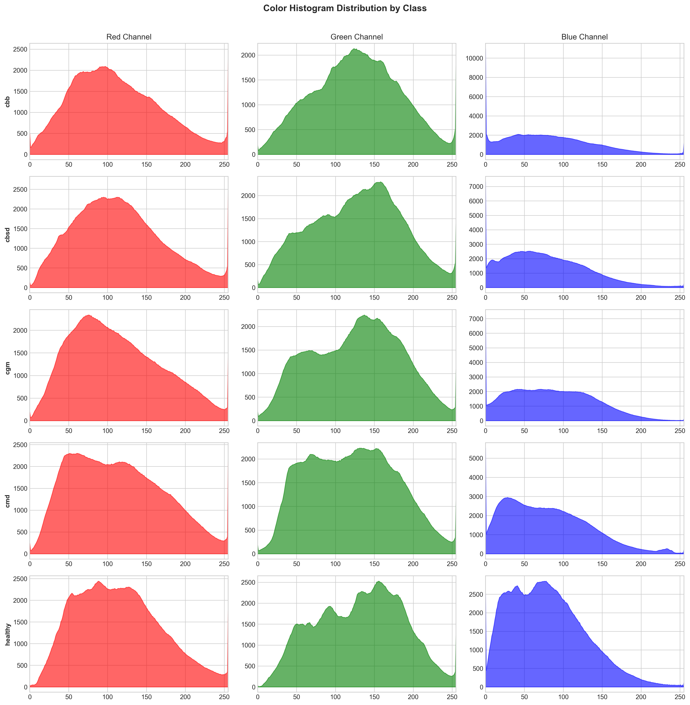 |

**Mean image per class** — a compact view of the average colour/texture signature of each condition:

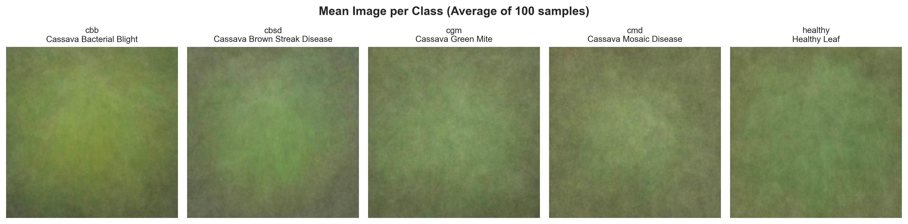

---

## 2️⃣ Preprocessing & Augmentation (Notebook 02)

* **Stratified 80/20 split** → 4,524 training / 1,132 validation images (class proportions preserved).
* **Resize to 224×224** and normalise with ImageNet statistics `mean=[0.485,0.456,0.406]`, `std=[0.229,0.224,0.225]`.
* **Augmentation** (training only): random flips, rotation, brightness/contrast shifts.
* **Class weights** to counter imbalance — minority classes up-weighted:

| Class | `cbb` | `cbsd` | `cgm` | `cmd` | `healthy` |
|-------|------:|-------:|------:|------:|----------:|
| Weight | 2.426 | 0.784 | 1.464 | 0.426 | 3.576 |

| Augmentation — CBB | Augmentation — CBSD |
|:---:|:---:|
| 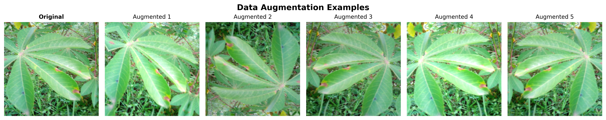 | 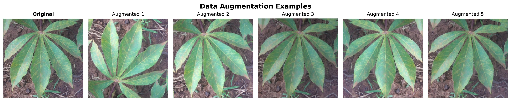 |

---

## 3️⃣ Feature Engineering (Notebook 03)

* VGG16 (frozen, ImageNet weights) is used as a **fixed feature extractor**.
* Features are **standardised** (scaler fitted on training data only) and reduced with **PCA**, retaining **3,201 components** that explain **94.83%** of the variance — roughly an **87% dimensionality reduction**.
* t-SNE and 2-D PCA projections confirm the features are class-informative (clusters partially overlap, as expected for biologically similar leaf disorders).

| PCA explained variance | t-SNE of engineered features |
|:---:|:---:|
| 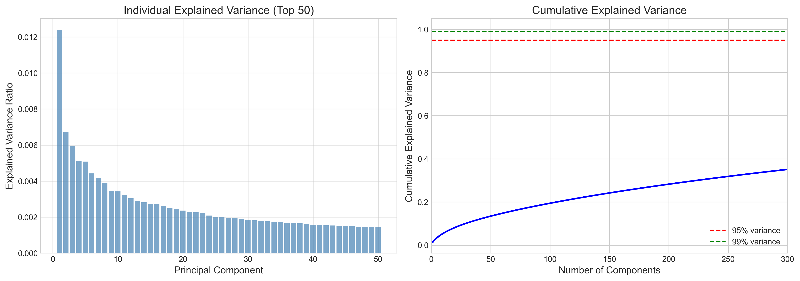 | 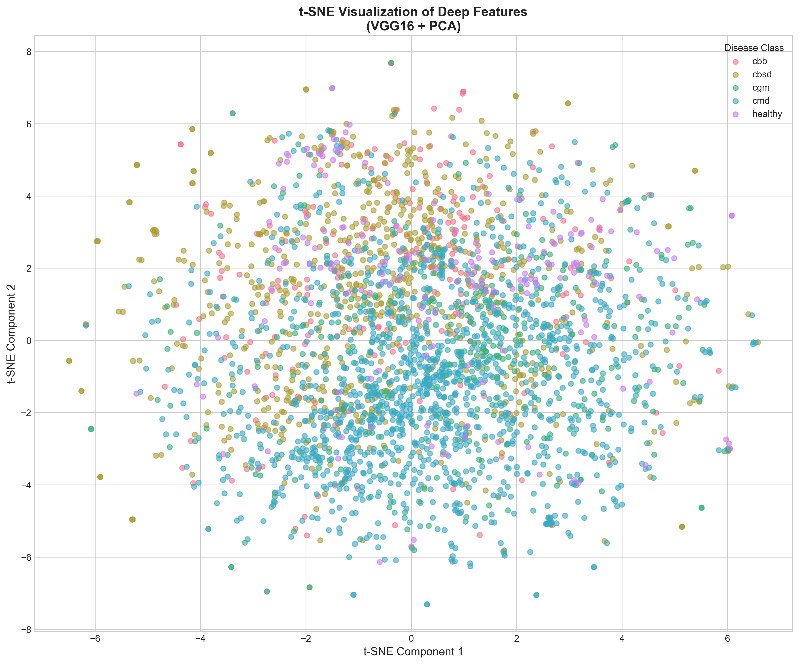 |

| 2-D PCA projection | Feature distribution (first components) |
|:---:|:---:|
| 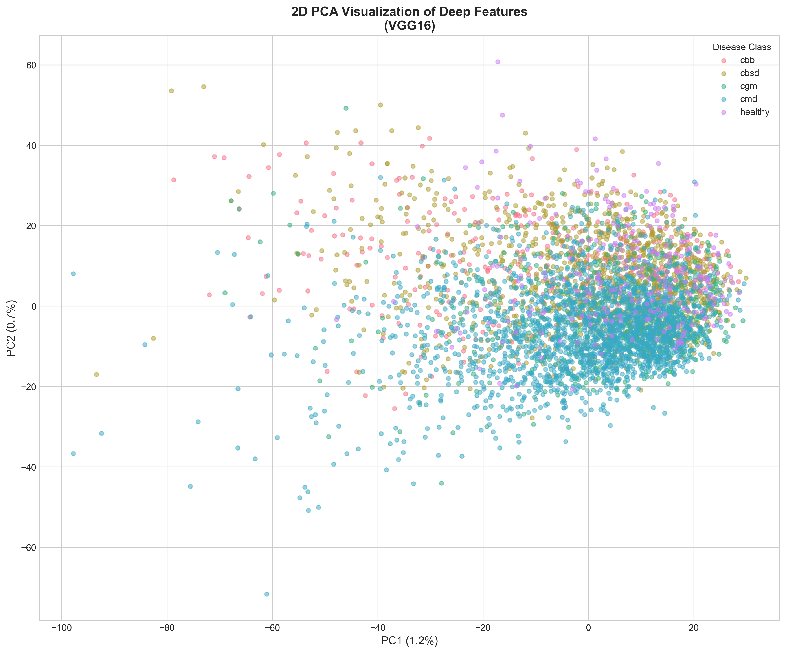 | 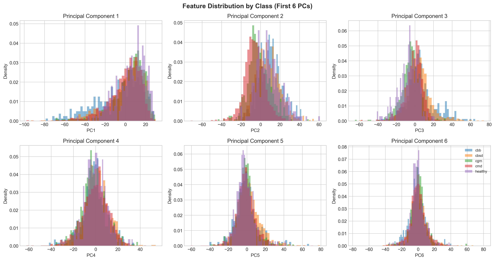 |

---

## 4️⃣ Model Training (Notebook 04)

Four models were trained to satisfy the coursework requirement of a **basic**, a **distance-based**, an **ensemble**, and an optional **deep** model.

| Model | Type | Train acc | Val acc | Train time |
|-------|------|----------:|--------:|-----------:|
| Logistic Regression | Basic | 99.89% | 68.90% | 19.14 s |
| SVM (RBF) | Distance-based | 99.58% | **71.91%** | 199.96 s |
| Random Forest | Ensemble | 100.00% | 52.65% | 6.05 s |
| Neural head (TorchClassifier) | Deep | 99.58% | 71.11% | 3.19 s |

> **Overfitting is visible** — especially the Random Forest, which reaches perfect training accuracy but weak validation accuracy on the high-dimensional sparse space. The optional neural head (Linear→512→256→5 with BatchNorm + Dropout, Adam, `ReduceLROnPlateau`) tracks SVM closely.

| Initial model comparison | Neural head training history |
|:---:|:---:|
| 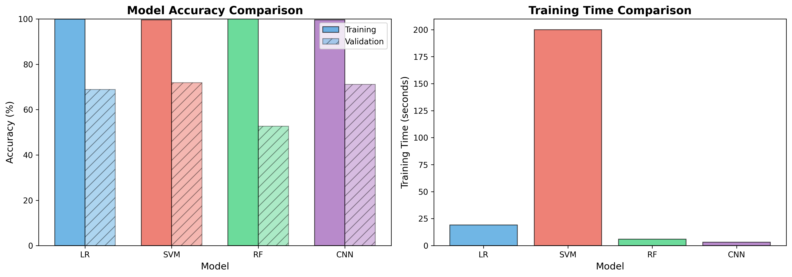 | 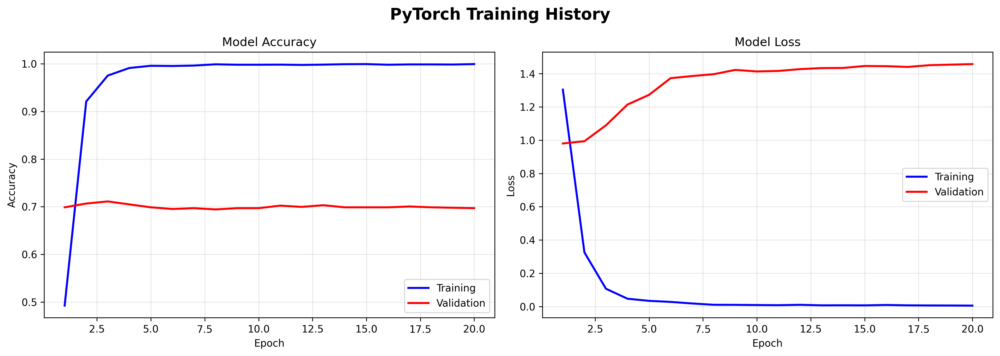 |

**Top-20 most important PCA components (Random Forest):**

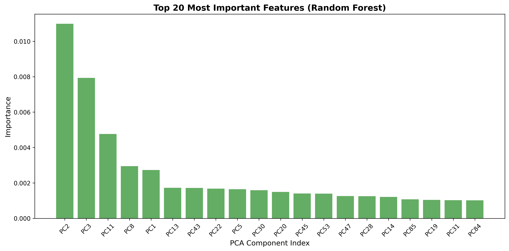

---

## 5️⃣ Hyperparameter Tuning (Notebook 05)

5-fold cross-validation was used with `GridSearchCV` (LR, SVM) and `RandomizedSearchCV` (RF).

| Model | Best parameters | Val accuracy | Val macro F1 | Search time |
|-------|-----------------|-------------:|-------------:|------------:|
| Logistic Regression | `C=0.01`, `class_weight=balanced`, `max_iter=1000`, `solver=lbfgs` | 70.85% | 0.593 | ~51 min |
| SVM (RBF) | `C=1.0`, `gamma=scale`, `kernel=rbf`, `class_weight=balanced` | 70.23% | 0.606 | ~124 min |
| Random Forest | `n_estimators=162`, `max_depth=40`, `min_samples_leaf=5`, `min_samples_split=5`, `class_weight=balanced` | 60.42% | 0.408 | ~151 min |

| Logistic Regression search | SVM search | Random Forest search |
|:---:|:---:|:---:|
| 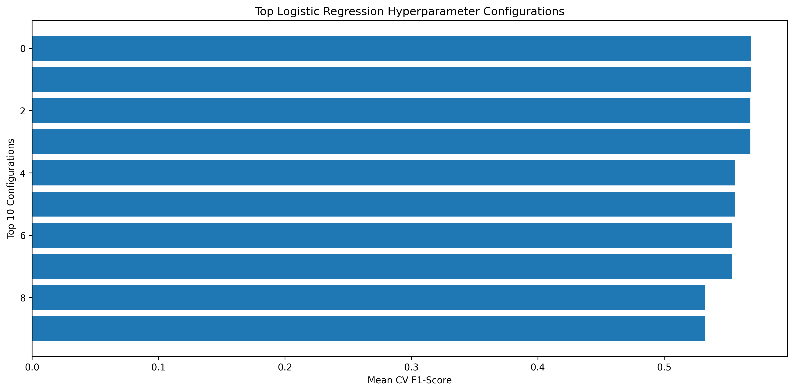 | 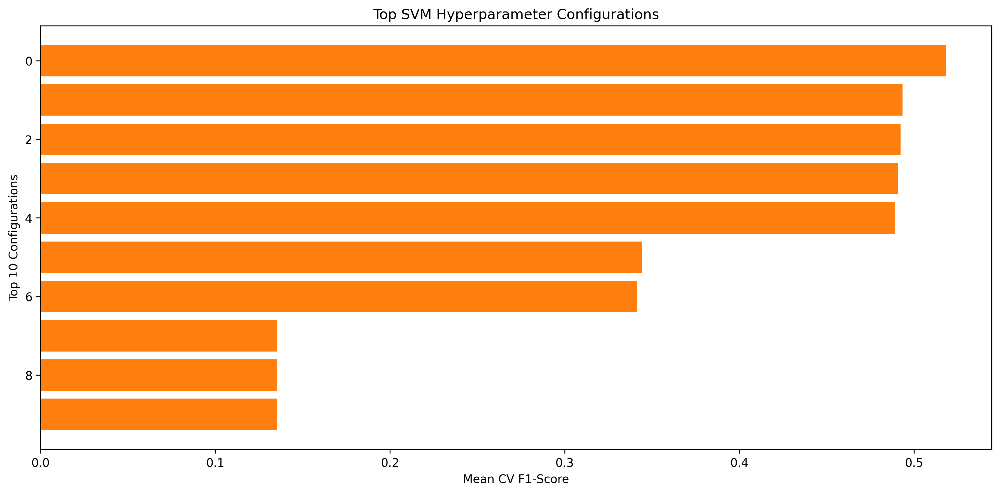 | 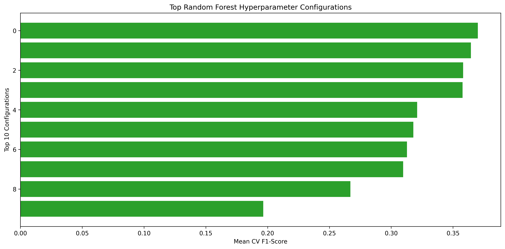 |

**Before vs. after tuning:**

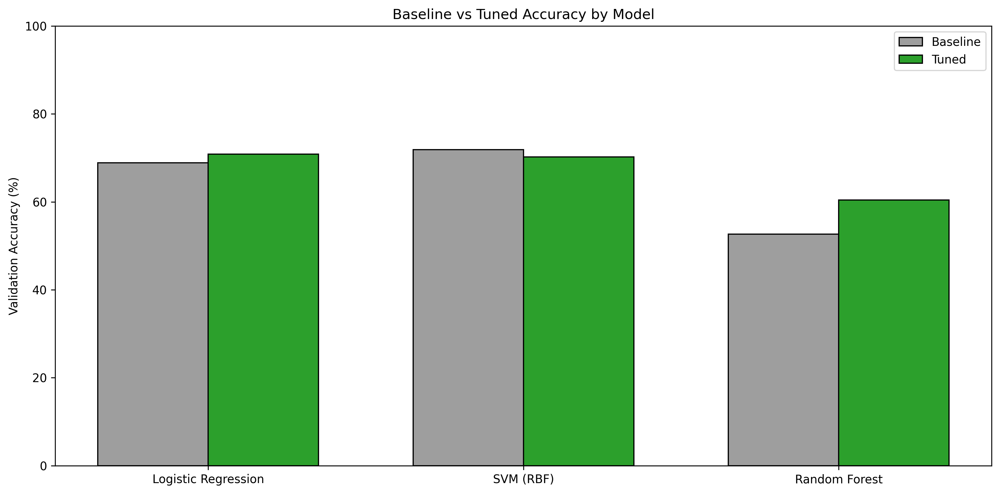

---

## 6️⃣ Model Evaluation & Comparison (Notebook 06)

### Macro-averaged metrics (validation set)

| Model | Accuracy | Precision | Recall | F1-score | AUC (macro) | AUC (micro) |
|-------|---------:|----------:|-------:|---------:|------------:|------------:|
| Logistic Regression | 70.85% | 61.02% | 58.17% | 59.26% | 0.875 | 0.913 |
| **SVM (RBF)** 🏆 | 70.23% | 61.04% | **60.65%** | **60.57%** | **0.885** | **0.917** |
| Random Forest | 60.42% | 50.22% | 41.19% | 40.78% | 0.791 | 0.854 |

**Per-class AUC (best model, SVM-RBF):** `cbb` 0.842 · `cbsd` 0.919 · `cgm` 0.824 · `cmd` 0.897 · `healthy` 0.942.

| Confusion matrices (all models) | ROC curves comparison |
|:---:|:---:|
| 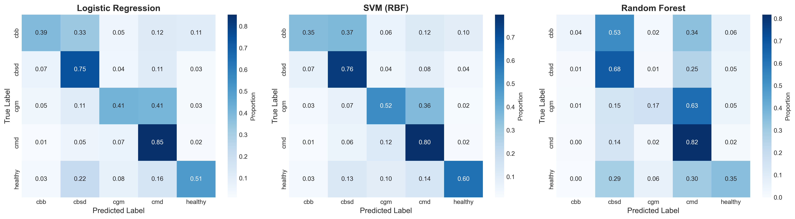 | 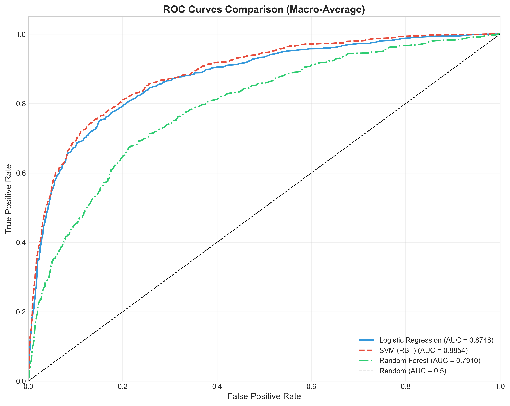 |

| Per-class ROC curves (best model) | Per-class performance |
|:---:|:---:|
| 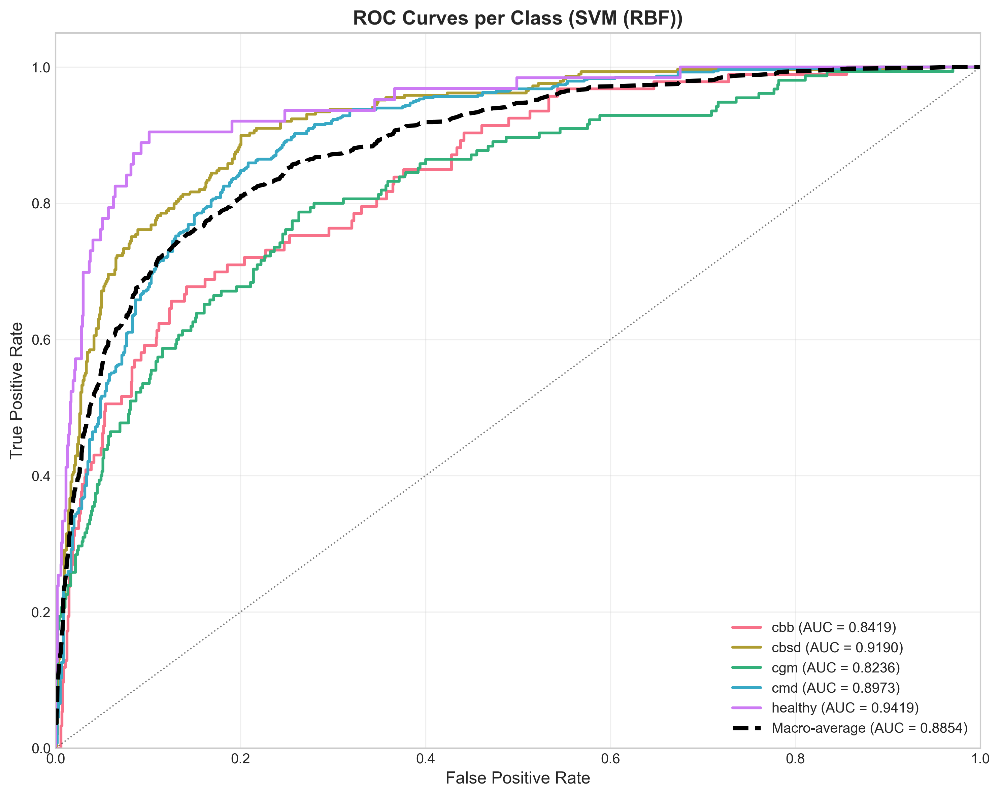 | 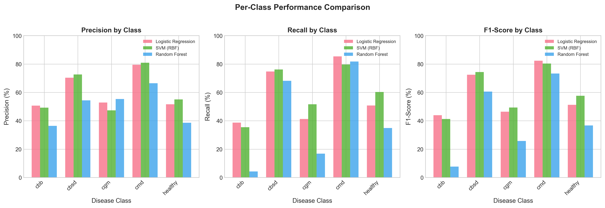 |

| Radar model comparison | Misclassification patterns |
|:---:|:---:|
| 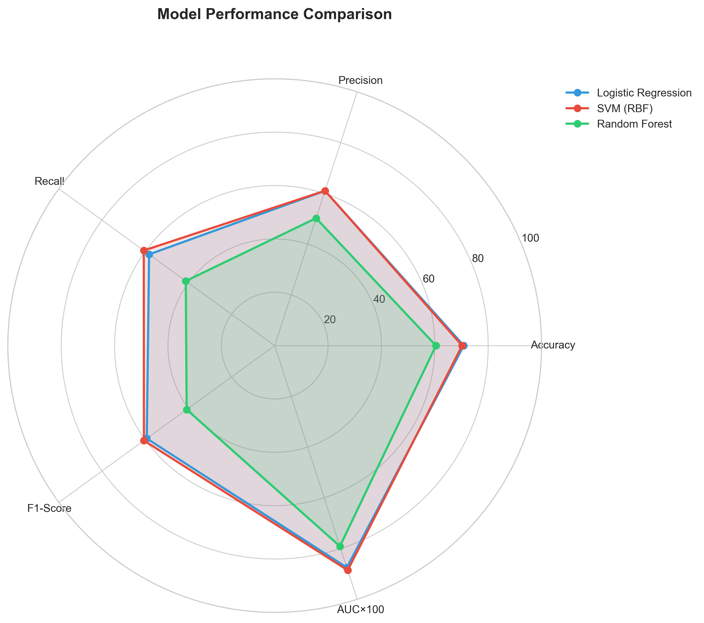 | 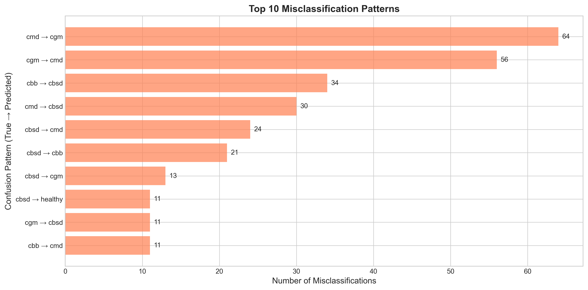 |

**Key findings**

* **SVM (RBF)** is selected as the best model — highest macro F1 and macro AUC, and the best balance between majority/minority classes.
* Overall misclassification rate is **29.77%**; the most common confusions are `cmd → cgm` (64), `cgm → cmd` (56) and `cbb → cbsd` (34).
* Accuracy alone is misleading under imbalance: Random Forest reaches ~100% train accuracy but collapses on minority classes (`cbb` recall = 4.3%).

---

## 7️⃣ Deployment (Notebook 07 + `predict.py`)

A reusable **`CassavaClassifier`** wraps the whole pipeline (preprocess → VGG16 features → scaler → PCA → classifier) and returns a class label, full disease name, confidence, and per-class probabilities. A standalone CLI (`predict.py`) supports single-image and batch prediction with optional JSON output.

```bash
# Single image
python predict.py cassava_leaf.jpg

# Save JSON result
python predict.py image.jpg -o result.json
```

```json
{
  "class": "cmd",
  "class_full": "Cassava Mosaic Disease",
  "confidence": 0.92,
  "probabilities": { "cbb": 0.02, "cbsd": 0.03, "cgm": 0.01, "cmd": 0.92, "healthy": 0.02 }
}
```

A smoke test on one sample per class produced correct predictions with **88%–98.6%** confidence.

| Prediction demo (image + class probabilities) | Sample prediction batch |
|:---:|:---:|
| 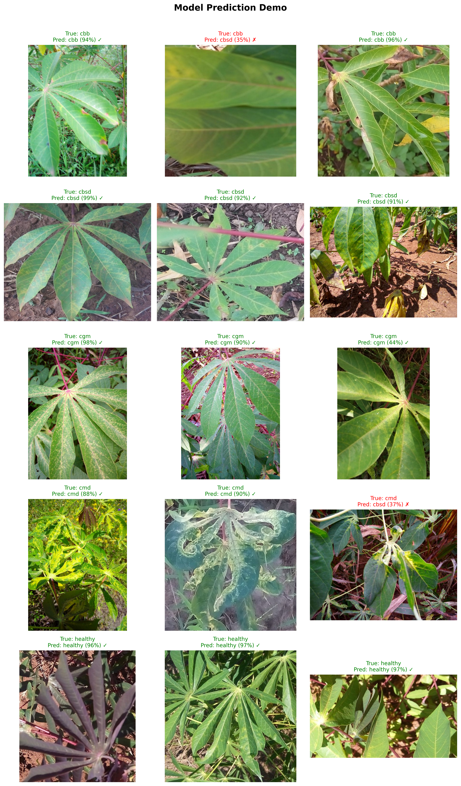 | 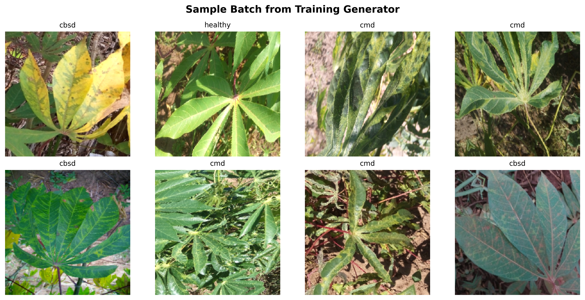 |

### ▶️ Running the Cassava project

```bash
cd cassava-disease_MLCW
python -m venv venv && venv\Scripts\activate      # Windows
pip install -r requirements.txt
jupyter notebook                                   # run 01 → 07 in order
```

> **Requirements:** Python 3.8+, PyTorch 2.2+, torchvision, scikit-learn, XGBoost, OpenCV, pandas, NumPy, matplotlib, seaborn, plotly, tqdm, joblib. A CUDA GPU is recommended (CPU training is 10–50× slower).

### ⚠️ Notes & limitations

* The local `test/test` image folder is empty (sample submission lists 3,774 IDs), so results are reported on the train/validation split.
* `feature_config.json` documents a 512-d pooled feature size while the logged pipeline reports a 3,201-component PCA — see the report's reproducibility note.
* Deployment in `07_deployment.ipynb` follows the evaluated **best model** from `evaluation_results.json`, whereas `predict.py` defaults to a Random Forest checkpoint — align these for production use.
* Cross-version scikit-learn warnings when reloading pickles highlight the value of pinning exact dependency versions.

> 📄 A full written report (introduction → literature → data → methods → evaluation → reflection → references) is available at [`cassava-disease_MLCW/ML_Coursework_Report.md`](cassava-disease_MLCW/ML_Coursework_Report.md).

---

# 💼 Project 2 — Adult Income Predictor Pro

> **Task:** Binary classification of whether an individual earns **>50K** or **≤50K** per year from US Census data.
> **Deliverable:** A packaged ML software product — a training script, a reusable feature-engineering module, a Jupyter coursework notebook, and a polished **Streamlit** app.

### 🎯 Dataset — UCI Adult / Census Income

| Property | Value |
|----------|-------|
| Total rows | **48,842** (interleaved train/test) |
| Train / Test split | **32,561 / 16,281** |
| Features | **14** (6 numeric, 8 categorical) |
| Target | `income` → `≤50K` (76.1%) / `>50K` (23.9%) |
| Missing values | `workclass`, `occupation`, `native_country` (encoded as `?`) |

**Missing values by column** and **income distribution** (generated from the coursework notebook):

| Missing values | Income distribution |
|:---:|:---:|
| 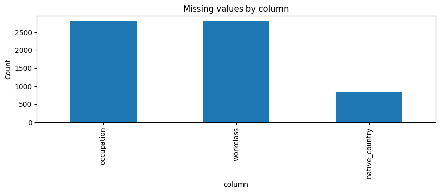 | 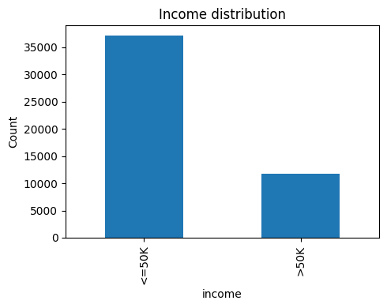 |

### 🔄 Pipeline

```text
  Raw row (14 features)
      │  AdultFeatureEngineer
      │    • capital_net = capital_gain − capital_loss
      │    • has_capital_gain / has_capital_loss flags
      │    • age_band (18-25 … 65+)  ·  hours_band (Part-time … Heavy)
      ▼
  ColumnTransformer
      │    • numeric  → SimpleImputer(median) + StandardScaler
      │    • categorical → SimpleImputer(most_frequent) + OneHotEncoder
      ▼
  Classifier (Logistic Regression / KNN / Random Forest)
      ▼
  Label (≤50K / >50K) + probability
```

**Engineered features:** `capital_net`, `has_capital_gain`, `has_capital_loss`, `age_band`, `hours_band` (on top of the original 14 columns).

### 📊 Model Results (test set)

| Model | Accuracy | Precision | Recall | F1 | ROC-AUC |
|-------|---------:|----------:|-------:|----:|--------:|
| Logistic Regression | **0.8597** | **0.7461** | 0.6157 | **0.6746** | **0.9115** |
| KNN (`k=21`, distance-weighted) | 0.8436 | 0.6860 | **0.6232** | 0.6531 | 0.8908 |
| Random Forest (deployed) | 0.8534 | 0.7222 | 0.6170 | 0.6655 | 0.9013 |

**Random Forest confusion matrix** (`n_estimators=220`):

| | Pred ≤50K | Pred >50K |
|---|---:|---:|
| **Actual ≤50K** | 11,522 | 913 |
| **Actual >50K** | 1,473 | 2,373 |

**Top feature importances (Random Forest):**

| Rank | Feature | Importance | Rank | Feature | Importance |
|-----:|---------|-----------:|-----:|---------|-----------:|
| 1 | `fnlwgt` | 0.1441 | 7 | `education_num` | 0.0622 |
| 2 | `age` | 0.1067 | 8 | `education` | 0.0561 |
| 3 | `marital_status` | 0.0981 | 9 | `hours_per_week` | 0.0545 |
| 4 | `occupation` | 0.0828 | 10 | `capital_gain` | 0.0532 |
| 5 | `relationship` | 0.0706 | 11 | `age_band` | 0.0460 |
| 6 | `capital_net` | 0.0642 | 12 | `workclass` | 0.0420 |

### 🖥 The Streamlit App

A four-page application:

1. **Dashboard** — headline metrics (rows, split, feature count, `>50K` share), dataset preview, missing-value and income-distribution charts.
2. **Data Explorer** — tabs to preview data, compare numeric features by income, and explore categorical distributions.
3. **Model Lab** — model-comparison table, top feature importances, and the Random Forest confusion matrix.
4. **Predict** — an interactive form for a single individual; outputs the predicted class with a **confidence bar**, and accumulates a **downloadable prediction history** (CSV).

### ▶️ Running the Adult project

```bash
cd adult_income_pro_app
pip install -r requirements.txt
python train_model.py          # trains + saves model & metrics
streamlit run app.py           # launches the web app
```

Or run the full workflow in Jupyter:

```bash
jupyter notebook notebooks/adult_income_coursework.ipynb
```

> **Requirements:** `streamlit`, `pandas`, `scikit-learn`, `joblib`, `numpy`, `jupyter`, `ipywidgets`, `matplotlib`.
> The saved bundle is packaged in **`packaged-demo`** mode (the deployment model is a pre-fit Random Forest); re-run `train_model.py` locally to regenerate all report tables fresh.

---

## 🧰 Technologies Used

| Layer | Tools |
|-------|-------|
| Language | Python 3.8+ |
| Classical ML | scikit-learn (Logistic Regression, KNN, SVM-RBF, Random Forest, PCA, GridSearchCV / RandomizedSearchCV) |
| Deep learning | PyTorch, torchvision (VGG16 transfer learning) |
| Data & vision | pandas, NumPy, OpenCV, Pillow |
| Visualisation | Matplotlib, Seaborn, Plotly |
| Deployment | Streamlit (app), CLI + Jupyter widgets (cassava) |
| Tooling | Jupyter, joblib, tqdm |

---

## ⚡ Quick Start (both projects)

```bash
git clone https://github.com/LihinduPerera/ML-CW.git
cd ML-CW

# Project 1 — Cassava (vision)
cd cassava-disease_MLCW && pip install -r requirements.txt && jupyter notebook

# Project 2 — Adult Income (tabular + app)
cd ../adult_income_pro_app && pip install -r requirements.txt
python train_model.py && streamlit run app.py
```

---

## 📌 Summary & Takeaways

* **Representation quality drives performance.** Pre-trained VGG16 features let classical classifiers work on images without end-to-end CNN retraining.
* **Evaluate beyond accuracy.** Under class imbalance, macro metrics and per-class recall reveal minority-class weaknesses hidden by majority-class performance (both projects).
* **Model choice is data-dependent.** SVM wins on the vision task; Logistic Regression is highly competitive on the tabular task while being far cheaper to train.
* **Reproducibility matters.** Version pinning and consistent notebook execution are essential for defensible results.

---

## 📄 License & Acknowledgements

This work is produced for **educational purposes** as part of a Machine Learning module.

* Dataset (Cassava): [Kaggle Cassava Leaf Disease Classification](https://www.kaggle.com/competitions/cassava-disease)
* Dataset (Adult): [UCI Adult / Census Income](https://archive.ics.uci.edu/dataset/2/adult)
* Pre-trained backbone: VGG16 (ImageNet weights)
* References: Breiman (2001); Cortes & Vapnik (1995); Simonyan & Zisserman (2015); Pedregosa et al. (2011); PyTorch & scikit-learn documentation.

<div align="center">

*Last updated: April 2026*

</div>
